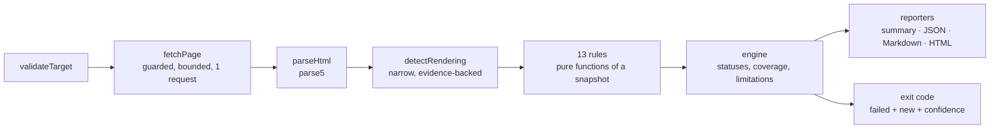

# PageScope

**Audit one web page's technical and SEO correctness without a browser.** PageScope fetches the page over HTTP, parses the served HTML, runs 13 rules, and returns findings that carry the evidence they were derived from — a source snippet with line and column, a response header, a measurement, or an explicit statement of what was searched for and not found.

It works as a CLI, as a library, and as an opt-in gate in CI.

## Status

**Pre-release.** Both packages are version `0.1.0` and neither is published to npm, so `npx pagescope` does not work yet. Run it from source (below). Two release-hygiene items are recorded in `docs/releasing.md` rather than smoothed over here: the `v0.1.0` tag predates the version alignment, and this install section has to be replaced with real npm instructions once the packages exist.

Everything below was run against this checkout on 3 November 2026 with Node 22.22.2 and pnpm 10.10.0 on Windows. CI pins pnpm 11 and runs the same commands on Node 22 and 24.

| Check                         | Result                                               |
| ----------------------------- | ---------------------------------------------------- |
| `tsc --noEmit`, both packages | clean                                                |
| `eslint .`                    | clean                                                |
| `prettier --check .`          | clean                                                |
| `tsup` build                  | core 64.8 kB JS + 18.3 kB types; CLI 11.0 kB         |
| Test suite                    | **182 passing in 19 files**, 36 s, no network access |

## Contents

- [Quick start](#quick-start)
- [What it checks](#what-it-checks)
- [Example output](#example-output)
- [Reading a report](#reading-a-report)
- [CLI reference](#cli-reference)
- [CI gate](#ci-gate)
- [Library](#library)
- [Boundaries](#boundaries)
- [Security model](#security-model)
- [Architecture](#architecture)
- [Development](#development)
- [Documentation](#documentation)
- [Roadmap](#roadmap)
- [Contributing](#contributing)
- [Licence](#licence)

## Quick start

```bash
git clone https://github.com/devalfian/website-auditor.git
cd website-auditor
pnpm install          # approve esbuild's build script when prompted
pnpm build
node packages/cli/dist/cli.js https://example.com
```

Node 22 or newer. There is no configuration file to create and no service to run.

## What it checks

13 rules across four categories. Severity is decided per rule, not per category, and no rule uses `critical` today: severity means "how much is demonstrably broken", not how alarming the category sounds.

| Rule                        | Severity | Reads        | What it verifies                                                   |
| --------------------------- | -------- | ------------ | ------------------------------------------------------------------ |
| `seo/title`                 | high     | served HTML  | `<title>` exists with non-empty text                               |
| `seo/meta-description`      | medium   | served HTML  | `<meta name="description">` exists and is non-empty                |
| `seo/canonical`             | low      | served HTML  | `<link rel="canonical">` exists and is absolute                    |
| `seo/robots-meta`           | medium   | served HTML  | reports `noindex` / `nofollow` for a human to judge                |
| `seo/open-graph`            | low      | served HTML  | `og:title`, `og:description`, `og:image`, `og:url` are present     |
| `seo/heading-structure`     | medium   | rendered DOM | no missing `<h1>`, no duplicate `<h1>`, no skipped level           |
| `technical/duplicate-id`    | medium   | served HTML  | no `id` value used by more than one element                        |
| `technical/meta-viewport`   | medium   | served HTML  | `<meta name="viewport">` is present                                |
| `technical/http-status`     | high     | HTTP headers | the final response is 2xx                                          |
| `a11y/img-alt`              | medium   | rendered DOM | every `` has an `alt` attribute                               |
| `a11y/html-lang`            | medium   | served HTML  | `<html lang>` exists and is non-empty                              |
| `security/https`            | high     | HTTP headers | the final URL is served over HTTPS                                 |
| `security/security-headers` | low      | HTTP headers | HSTS, CSP, `X-Content-Type-Options`, `Referrer-Policy` are present |

Two rules need the DOM after JavaScript, and say so instead of guessing: on a page PageScope detects as client-rendered they report `unobservable`. The other eleven read `<head>`, `<html>` attributes, response headers or the status line, all of which exist in the raw response.

Every rule has its own document under [`docs/rules/`](docs/rules), and each one contains a **"What this rule does not check"** paragraph. `seo/title` checks presence, not quality or length. `security/https` does not inspect certificates. `security/security-headers` reports an absent header and stops there — it makes no exploitability claim.

## Example output

Real output from `node packages/cli/dist/cli.js https://example.com` on 3 November 2026, with the colour codes removed:

```
PageScope — https://example.com
status: completed | findings: 5 | 528ms
coverage: served-html (server-rendered) | 13/13 rules evaluated
not inspected: rendered-dom, linked-pages, wcag-conformance, exploitability

[ok]   seo/title — title length: 14 characters
[fail] seo/meta-description
[fail] seo/canonical
[ok]   seo/robots-meta — no robots meta directive present
[fail] seo/open-graph
[fail] seo/heading-structure
[ok]   technical/duplicate-id — no id attributes on the page
[ok]   technical/meta-viewport — viewport meta present
[ok]   technical/http-status — HTTP 200
[-]    a11y/img-alt — no  elements on the page
[ok]   a11y/html-lang — html lang="en"
[ok]   security/https — final URL is https://example.com/
[fail] security/security-headers

Findings:
  medium   Missing meta description (seo/meta-description) [confidence: high]
  low      Missing canonical URL (seo/canonical) [confidence: high]
  low      Missing Open Graph properties (seo/open-graph) [confidence: high]
  medium   No <h1> on the page (seo/heading-structure) [confidence: high]
  low      Missing security headers (security/security-headers) [confidence: high]

Limitations:
  - JavaScript is not executed: only the raw HTML response is inspected.
  - Only the single requested page is audited; links are not crawled.
  - Automated checks cannot establish WCAG conformance or prove that a page is exploitable.
```

The `packages/core/fixtures/` pages are synthetic and exist so rules can be demonstrated and tested. Any sample report in this repository comes from those fixtures or from `example.com` — never from a customer site.

## Reading a report

### Statuses

| Status           | Meaning                                                                           | Set by      |
| ---------------- | --------------------------------------------------------------------------------- | ----------- |
| `passed`         | the rule ran and the condition held                                               | rule        |
| `failed`         | the rule ran and the condition did not hold                                       | rule        |
| `needs-review`   | the rule ran, but the right answer depends on intent PageScope cannot know        | rule        |
| `not-applicable` | the rule had nothing to apply to (for example `img-alt` on a page with no images) | rule        |
| `unobservable`   | the rule could not see enough of the page to conclude                             | engine only |
| `error`          | the rule did not complete                                                         | engine only |

A terminal glyph follows the status: `[ok]`, `[fail]`, `[!]` for needs-review, `[-]` for not-applicable, `[?]` for unobservable.

Two invariants hold this together. **A rule that did not run is never reported as `passed`**, enforced by `assertResultInvariants` and by the fact that a rule's return type cannot express `unobservable` or `error`. And `unobservable` is separate from `not-applicable` because "there are verifiably no images here" and "I could not see the body" are different claims; reporting both as `[-]` told the reader nothing.

A finding exists only for `failed` and `needs-review`. `passed`, `not-applicable`, `unobservable` and `error` carry a note instead, because there is nothing to fix.

In the terminal each rule is marked `[ok]`, `[fail]`, `[?]` for needs-review **or** unobservable, `[-]` for not-applicable, and `[err]` when the rule threw. When any rule was unobservable, the coverage line names them, so `[?]` is never the only hint.

### Evidence

Every finding carries at least one piece of evidence, and it is a discriminated union rather than a prose string:

| Kind            | Contains                                                       |
| --------------- | -------------------------------------------------------------- |
| `html-snippet`  | the exact source text, with line, column and a truncation flag |
| `http-header`   | a response header name and value                               |
| `http-response` | status, final URL and the redirect chain                       |
| `measurement`   | a counted or measured value, with an optional unit             |
| `absence`       | what was searched for and where, when nothing was found        |

`absence` exists so "we looked and found nothing" can be stated as itself. A missing `<title>` never comes with a fabricated `<title>` tag next to it.

### Coverage, and why the limitations can be trusted

Every report carries a `coverage` block: which representation was read (`served-html` or `rendered-dom`), whether that representation is faithful and the evidence for that judgement, how many rules reached a conclusion, which rules the engine refused to conclude, and what was deliberately **not** inspected.

The limitation sentences are derived from that block by `limitationsFor()` in `engine/limits.ts`. Nothing is asserted unconditionally: remove `linked-pages` from `notInspected` when crawling ships, and the sentence about crawling disappears from every report without anyone remembering to edit it.

### Severity is not confidence

| Confidence | Means                                                          |
| ---------- | -------------------------------------------------------------- |
| `high`     | a direct reading of the served bytes; no assumption            |
| `medium`   | depends on a convention the specification does not force       |
| `low`      | depends on an assumption that is stated but cannot be verified |

Confidence is orthogonal to severity and to status. It is printed in the terminal summary, Markdown and HTML, and it decides whether a finding is allowed to fail the build (`--min-confidence`). A `missing security-header` finding is reported as absent with `high` confidence; what an attacker could do with it is a separate claim PageScope does not make.

Each finding also carries a `docsUrl` pointing at its rule document, so a reader can check what the rule does and does not check without leaving the report.

## CLI reference

```bash
pagescope <url> [options]
```

| Option                     | Default   | What it does                                                                       |
| -------------------------- | --------- | ---------------------------------------------------------------------------------- |
| `--format <format>`        | `summary` | `summary`, `json`, `markdown`, `html` or `all`                                     |
| `--out <path>`             | stdout    | Write the report to a file instead of printing it. Required by `--format all`      |
| `--fail-on <severity>`     | `none`    | Exit `1` when a counted finding is at or above this severity                       |
| `--min-confidence <level>` | `low`     | Findings below this confidence are reported but do not count towards the exit code |
| `--rules <ids>`            | all 13    | Comma-separated rule ids to run                                                    |
| `--exclude-rules <ids>`    | none      | Comma-separated rule ids to skip                                                   |
| `--config <path>`          | none      | Read a `pagescope.config.json`                                                     |
| `--baseline <path>`        | none      | Mark findings `known` or `new` against a recorded baseline                         |
| `--write-baseline <path>`  | none      | Record this run as a baseline and exit `0` without judging the policy              |
| `--timeout <ms>`           | `10000`   | Total request deadline; also bounded by a 5 MiB response cap and 5 redirects       |
| `--verbose`                | off       | Extra diagnostics on stderr                                                        |
| `--no-color`               | colour on | Disable colour in the terminal summary                                             |

`--baseline` and `--write-baseline` cannot be combined; the CLI refuses rather than picking one.

**Formats.** `summary` is what the example above shows. `json` is validated against the report schema and carries `SCHEMA_VERSION` (`1.1.0`). `markdown` groups findings by severity and fences snippets. `html` is a single self-contained file with no JavaScript, a restrictive CSP meta tag, and every value escaped. `--format all --out reports/audit` writes `reports/audit.json`, `reports/audit.md` and `reports/audit.html`.

**Config file.** Keys are `failOn`, `minConfidence`, `format`, `timeoutMs`, `rules` and `excludeRules`. The schema is strict, so a typo like `failon` fails with exit `2` instead of being ignored. A flag given on the command line always wins over the same key in the file.

```json
{
  "failOn": "high",
  "minConfidence": "medium",
  "format": "markdown"
}
```

**Exit codes.**

| Code | Meaning                               | What it usually means for you                    |
| ---- | ------------------------------------- | ------------------------------------------------ |
| `0`  | Audit completed and the policy passed | nothing to do                                    |
| `1`  | Audit completed but the policy failed | read the report                                  |
| `2`  | Invalid input or configuration        | fix the command, not the site                    |
| `3`  | The target could not be audited       | check reachability or the guard's refusal reason |

Codes `2` and `3` are not policy failures. Treating them as "the site is bad" is a misreading of the output.

## CI gate

The gate is opt-in: `--fail-on` defaults to `none`, so a plain run never fails a build because it found something.

```bash
node packages/cli/dist/cli.js https://example.com --fail-on high
node packages/cli/dist/cli.js https://example.com --format markdown --out report.md
node packages/cli/dist/cli.js https://example.com --format all --out reports/audit
```

`--fail-on` counts only findings whose status is `failed`. A `needs-review` finding says "PageScope cannot determine which case applies here", which is not an assertion that something is broken, so it is reported and never fails the gate. `--min-confidence` adds a second filter: a `failed` finding below the threshold still appears in the report, but the summary says how many were left out of the exit code:

```
gate: 2 failed findings below --min-confidence high were not counted
```

### Baseline mode

A gate that fails on findings you already know about gets switched off within a week. Record the current state once, then fail only on what is new:

```bash
# record the current findings
node packages/cli/dist/cli.js https://example.com --write-baseline .pagescope-baseline.json

# later, in CI: only new findings can fail the build
node packages/cli/dist/cli.js https://example.com --baseline .pagescope-baseline.json --fail-on high
```

The summary reports `new`, `known` and `stale` counts. Deliberately:

- Known findings still appear in every report, marked `known`. Nothing is hidden, because a hidden finding makes the report lie.
- `--fail-on` applies only to `new` findings while a baseline is in use.
- `--write-baseline` exits `0` without evaluating the policy: recording state is not a verdict.
- Identity is a hash of the rule id plus a **semantic** discriminator — a duplicated `id` value, an image `src` — never a line number. Inserting a paragraph above a finding does not make the baseline forget it, and a test asserts exactly that.
- A baseline recorded for one page is not meaningful for another, and `--rules` on a full baseline reports the other rules' entries as `stale`.

[`examples/github-actions/audit.yml`](examples/github-actions/audit.yml) is a copy-pasteable workflow: run the audit, upload the Markdown report with `if: always()`, fail the job on `--fail-on high`. Its README explains that it needs the npm package, which does not exist yet.

## Library

`@pagescope/core` is the same engine the CLI calls. Nothing in it knows the CLI exists.

```ts
import { audit, toMarkdownReport } from '@pagescope/core'

const result = await audit({ url: 'https://example.com' })
console.log(result.status, result.findings.length)
console.log(toMarkdownReport(result))
```

Also exported: `validateTarget` for checking a URL without fetching it, `limitationsFor(coverage)` if you render coverage yourself, `toJsonReport` / `toHtmlReport`, `selectRules`, and `createBaseline` / `applyBaseline` / `parseBaseline` for baseline handling outside the CLI.

## Boundaries

These are not TODOs. Each one is a boundary the report states about itself, and `coverage.notInspected` names the ones that still apply.

| Boundary                                                                                                      | Why it exists                                                                                                                                                                                                  |
| ------------------------------------------------------------------------------------------------------------- | -------------------------------------------------------------------------------------------------------------------------------------------------------------------------------------------------------------- |
| **No JavaScript execution.** Only the raw HTML response is inspected.                                         | A browser would make every run slower and unusable on a bare CI runner. The two rules that need the rendered DOM report `unobservable` on pages PageScope detects as client-rendered, instead of a false pass. |
| **One page per run.** Links are not crawled.                                                                  | Crawling changes the security model and the promise of the tool.                                                                                                                                               |
| **No score.** Statuses, severities and confidence only.                                                       | One number hides which findings are guesses.                                                                                                                                                                   |
| **No WCAG conformance claim.**                                                                                | Automated checks cannot establish conformance, and the report says so every time.                                                                                                                              |
| **No exploitability claim.**                                                                                  | A missing header is reported as absent. Nothing follows from it in the report.                                                                                                                                 |
| **No certificate inspection.**                                                                                | `security/https` checks the scheme of the final URL, and its document says that is all it checks.                                                                                                              |
| **No hosted service.**                                                                                        | There is no public endpoint, by design.                                                                                                                                                                        |
| **Private and reserved addresses are refused at connect time**, including IP literals and every redirect hop. | Auditing `localhost` is impossible on purpose: this is the control that keeps the tool from becoming an SSRF proxy.                                                                                            |

Client-rendered detection is deliberately narrow. PageScope calls a page `client-rendered` only when it can point at the evidence: a mount element it recognises (`#root`, `#app`, `#__next`, `#__nuxt`, `#___gatsby`, `<app-root>`) with no element children, or an explicit "enable JavaScript" message. A single-page app that renders into a mount point already holding a placeholder is **not** detected, and behaves exactly as before. A missed detection costs a rule its `unobservable` status; a guessed detection would cost the tool its credibility.

## Security model

PageScope fetches URLs chosen by the user, which makes it a potential SSRF proxy and a potential resource sink. Both are treated as first-class problems, with a control and a test each ([`docs/security/threat-model.md`](docs/security/threat-model.md) lists the full matrix):

- **Every resolved address is classified before a socket opens.** Loopback, RFC1918, link-local (including the cloud metadata address), CGNAT, multicast, reserved space, IPv6 ULA/link-local, and IPv4-mapped IPv6 are refused. Classification happens inside the DNS `lookup` callback, so the address used to connect is the address that was validated — which closes the DNS-rebinding window between validation and connection.
- **IP literals are checked separately**, because Node skips DNS when the host is already an address, and an unchecked `http://169.254.169.254/` would bypass the lookup entirely. The same check runs on the initial URL and on every redirect hop.
- **Redirects are followed manually**, re-validated per hop, capped at five.
- **Responses are bounded**: a 10 s default deadline and a 5 MiB streaming cap that destroys the socket when exceeded, so a slow or endless response cannot exhaust memory or CI minutes.
- **Nothing from the audited page is trusted when rendering.** The HTML report escapes every dynamic value, contains no JavaScript and carries `Content-Security-Policy: default-src 'none'`. Terminal output strips ANSI escapes, C0/C1 control characters and bidi overrides, so a hostile page title cannot rewrite the summary.
- **Sensitive headers do not reach reports.** `set-cookie` values are discarded at collection time (cookie names are kept, values are not) and `authorization` is dropped entirely.
- **Report paths come only from `--out`.** No path component is derived from the audited URL, and a directory target is refused.

If you expose PageScope as a hosted service, the controls it does not provide are yours to add: authentication and authorisation for anyone who can submit a URL, rate limiting, network egress isolation, and log hygiene. Nothing in this repository claims that a publicly exposed instance is safe.

## Architecture



```
packages/core   @pagescope/core   contracts · collection · engine · rules · reporters
packages/cli    pagescope         argument parsing · exit codes · file output
```

Collection is separated from evaluation on purpose. `fetchPage` performs exactly one network operation and returns either a snapshot or an error; rules receive the snapshot and nothing else. That is what makes every rule testable from an HTML string with no server and no network, and it is why a rule cannot quietly issue an extra request.

Three invariants are enforced rather than documented:

1. **A rule that did not run is never `passed`.** `assertResultInvariants` rejects a result that claims a conclusion without a finding, or a finding without a conclusion, and `unobservable` is unrepresentable in a rule's return type.
2. **Reports are validated.** Every result is checked against a zod schema before serialisation and carries `SCHEMA_VERSION` (`1.1.0`, moved from `1.0.0` when fingerprints and baseline markers were added).
3. **Limitations are derived, not written.** `limitationsFor(coverage)` turns coverage facts into sentences, so a report cannot claim a limitation the audit did not have.

## Development

```bash
pnpm install          # approve esbuild's build script when prompted
pnpm typecheck        # tsc --noEmit, both packages
pnpm lint             # eslint, flat config
pnpm format:check     # prettier
pnpm build            # tsup, both packages
pnpm test             # 182 tests in 19 files, no network access
```

`pnpm verify` runs typecheck, lint, test and build in that order; CI additionally runs `format:check` and both `npm pack --dry-run` checks.

Two things about the suite are deliberate. No test touches the network: rules are pure functions of a snapshot, so their tests build one from an HTML string. And `packages/core/test/engine/audit.test.ts` asserts the rule count, so registering a rule fails the suite until the number is updated — friction that makes a change to the public rule list visible in review.

> **Windows:** if `pnpm <script>` fails with `uname: command not found`, your global `script-shell` points at a bash without coreutils. Point `script-shell` at `cmd.exe`, or run the tool directly: `node node_modules/vitest/vitest.mjs run`.

Adding a rule is a five-file change — rule, registry entry, test, `docs/rules/<slug>.md`, rule count — and never touches the engine. The walkthrough in [`docs/contributing/adding-a-rule.md`](docs/contributing/adding-a-rule.md) is real code, not pseudo-code.

## Documentation

| Document                                                                   | What it covers                                                             |
| -------------------------------------------------------------------------- | -------------------------------------------------------------------------- |
| [`docs/architecture.md`](docs/architecture.md)                             | Pipeline, status model, coverage, contracts, baseline identity, exit codes |
| [`docs/rules/`](docs/rules)                                                | One page per rule, each with "What this rule does not check"               |
| [`docs/security/threat-model.md`](docs/security/threat-model.md)           | Ten threats, the control for each, and the test that proves it             |
| [`docs/contributing/adding-a-rule.md`](docs/contributing/adding-a-rule.md) | End-to-end rule walkthrough                                                |
| [`docs/releasing.md`](docs/releasing.md)                                   | Publish order, why `pnpm publish` and not `npm publish`, tag hygiene       |
| [`SECURITY.md`](SECURITY.md)                                               | Supported versions, how to report, what a self-hoster owns                 |
| [`CONTRIBUTING.md`](CONTRIBUTING.md)                                       | Setup, commands, what a good finding looks like                            |
| [`examples/github-actions/`](examples/github-actions)                      | A copy-pasteable CI workflow, and what it needs first                      |

## Roadmap

Planned, not started. None of it exists in `0.1.0`.

- **Publish the two packages**, in the order and under the pre-flight in `docs/releasing.md`.
- **Broken-link checking**, which means crawling, which means revisiting the security model first.
- **A browser adapter** for rendered-DOM audits, as a third package so Chromium never becomes a dependency of the library.
- **A hosted dashboard**, with authentication — the part PageScope deliberately does not have today.

## Contributing

Contributions are welcome, and the bar is evidence rather than enthusiasm. A change that makes findings less trustworthy is rejected even if it adds features.

If you add or change a rule, four rules apply: evidence is what was observed (never a fabricated snippet), a status must match what actually happened, ambiguity is `needs-review` rather than `failed`, and no finding may overclaim beyond its own check. Tests must run offline.

See [`CONTRIBUTING.md`](CONTRIBUTING.md) for setup and the pull-request checklist, and [`CODE_OF_CONDUCT.md`](CODE_OF_CONDUCT.md) for the Contributor Covenant.

Report security problems through GitHub private vulnerability reporting, not a public issue. [`SECURITY.md`](SECURITY.md) says what a useful report contains and where the interesting boundaries are.

## Licence

MIT. Copyright 2026 Alfian Purwanto. See [`LICENSE`](LICENSE).
